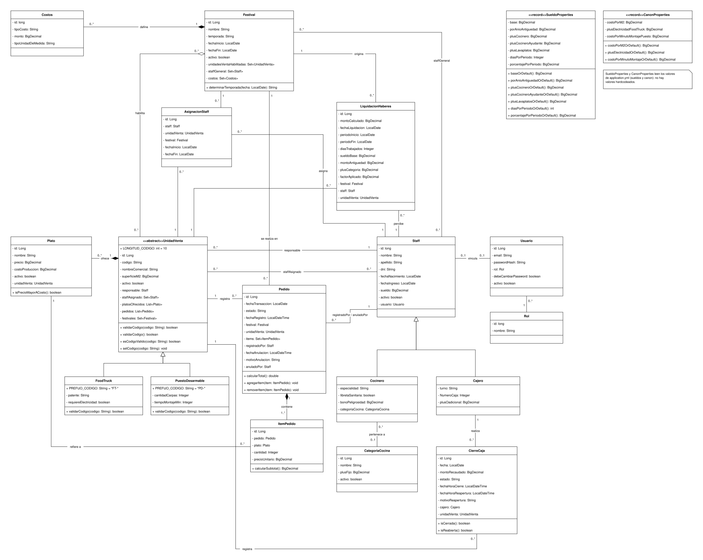

# TP Grupal OO2 - Hito 2 - Grupo 03

## Sistema de Gestión de Festivales Gastronómicos

Aplicación web para la gestión de festivales gastronómicos, sus unidades de venta y el personal asociado. El sistema permite administrar la información de los festivales y de las unidades participantes, contemplando distintos tipos de unidades de venta, pedidos, caja, reportes y roles de usuario.

> [!IMPORTANT]
> **Estado del desarrollo y sincronización de ramas (`dev` y `main`):**
> Todo el ciclo de desarrollo, la implementación de funcionalidades, los flujos de negocio y las pruebas unitarias fueron realizados y verificados exhaustivamente en la rama **`dev`**, donde el sistema funciona de manera completa e integral. Posteriormente, todo el contenido de `dev` fue **mergeado a la rama `main`** para la entrega final, por lo que ambas ramas se encuentran sincronizadas con la última versión operativa y los 19 tests automatizados pasando exitosamente.

## Integrantes

| Integrante | Usuario de GitHub |
| --- | --- |
| Roberto Andrés Ruiz Pereira | [@rpruiz33](https://github.com/rpruiz33) |
| Federico Matías Salvatierra | [@Fsalvatierra](https://github.com/Fsalvatierra) |
| Leonel Alejandro Soloaga | [@Le0oneL](https://github.com/Le0oneL) |
| Ana Belén Vázquez | [@anavazquez141](https://github.com/anavazquez141) |

## Tecnologías utilizadas

- Java 17 como entorno de desarrollo y ejecución (configurado en Maven con `java.version` 17).
- Spring Boot.
- Spring MVC y Thymeleaf para la interfaz web.
- Spring Security para la autenticación y autorización por roles.
- Spring Data JPA e Hibernate para la persistencia.
- MySQL como base de datos.
- Maven para la gestión del proyecto y sus dependencias.
- Visual Studio Code como entorno de desarrollo.

## Diagrama de clases y documentación adicional

El modelo de dominio y la documentación de la aplicación se encuentran versionados en el repositorio:

- 📄 [Diagrama de Clases UML (SVG)](./UML.svg)
- 📐 [Diagrama editable en Draw.io (XML)](./UML.drawio)
- 📑 [Consigna del Trabajo Práctico (PDF)](./Trabajo%20Practico%20OO2%20Hito%202%20V2%20-%20Trabajo%20Practico%20OO2%20Hito%202%20V2.pdf)




## Pull requests

Las funcionalidades y cambios del proyecto fueron integrados mediante pull requests mergeadas en la rama `dev`:

| Pull request | Funcionalidad | Realizado por |
| --- | --- | --- |
| [#101](https://github.com/rpruiz33/TPGrupalOO2Hito2Grupo3/pull/101) | Integración final de `dev` en `main` | Leonel Alejandro Soloaga |
| [#99](https://github.com/rpruiz33/TPGrupalOO2Hito2Grupo3/pull/99) | Eliminación de clases y métodos Spring `.xlsx` no utilizados | Leonel Alejandro Soloaga |
| [#98](https://github.com/rpruiz33/TPGrupalOO2Hito2Grupo3/pull/98) | Integración de cambios de `dev` | Leonel Alejandro Soloaga |
| [#97](https://github.com/rpruiz33/TPGrupalOO2Hito2Grupo3/pull/97) | Corrección del rol `empleado@epicentro.com` | Leonel Alejandro Soloaga |
| [#96](https://github.com/rpruiz33/TPGrupalOO2Hito2Grupo3/pull/96) | Integración de cambios de `dev` | Federico Matías Salvatierra |
| [#95](https://github.com/rpruiz33/TPGrupalOO2Hito2Grupo3/pull/95) | Validación de edad para usuarios | Federico Matías Salvatierra |
| [#93](https://github.com/rpruiz33/TPGrupalOO2Hito2Grupo3/pull/93) | Fixes con temporadas: validación obligatoria, cálculo automático según fecha (hemisferio sur), selector en formularios y ajuste de staff | Roberto Andrés Ruiz Pereira |
| [#92](https://github.com/rpruiz33/TPGrupalOO2Hito2Grupo3/pull/92) | Mejorar liquidaciones, empleados y registro de unidades de venta | Leonel Soloaga |
| [#91](https://github.com/rpruiz33/TPGrupalOO2Hito2Grupo3/pull/91) | Sincronización de fechas al actualizar festival y corrección del ABM de festivales y liquidaciones | Leonel Alejandro Soloaga |
| [#90](https://github.com/rpruiz33/TPGrupalOO2Hito2Grupo3/pull/90) | Liquidación, recaudación y rentabilidad neta: liquidación por email, cálculo riguroso sin fallback a cero, selector de festival y restricción por rol | Roberto Andrés Ruiz Pereira |
| [#88](https://github.com/rpruiz33/TPGrupalOO2Hito2Grupo3/pull/88) | fix liquidaciones mensuales y recibos individuales | Leonel Soloaga |
| [#87](https://github.com/rpruiz33/TPGrupalOO2Hito2Grupo3/pull/87) | validaciones y seguridad de empleados y festivales | Leonel Soloaga |
| [#85](https://github.com/rpruiz33/TPGrupalOO2Hito2Grupo3/pull/85) | Plantillas de error HTTP personalizadas (400, 401, 403, 404, 500) y redirección de accesos denegados | Federico Matías Salvatierra |
| [#84](https://github.com/rpruiz33/TPGrupalOO2Hito2Grupo3/pull/84) | Documentación de validaciones adicionales de carga | Ana Belén Vázquez |
| [#83](https://github.com/rpruiz33/TPGrupalOO2Hito2Grupo3/pull/83) | Baja lógica de unidades de venta | Ana Belén Vázquez |
| [#82](https://github.com/rpruiz33/TPGrupalOO2Hito2Grupo3/pull/82) | ABM de festivales y baja lógica | Roberto Andrés Ruiz Pereira |
| [#80](https://github.com/rpruiz33/TPGrupalOO2Hito2Grupo3/pull/80) | Actualización funcional | Roberto Andrés Ruiz Pereira |
| [#79](https://github.com/rpruiz33/TPGrupalOO2Hito2Grupo3/pull/79) | Reversión de cambios de festivales | Roberto Andrés Ruiz Pereira |
| [#78](https://github.com/rpruiz33/TPGrupalOO2Hito2Grupo3/pull/78) | Reversión de cambios de festivales | Roberto Andrés Ruiz Pereira |
| [#77](https://github.com/rpruiz33/TPGrupalOO2Hito2Grupo3/pull/77) | Reversión de cambios de festivales | Roberto Andrés Ruiz Pereira |
| [#76](https://github.com/rpruiz33/TPGrupalOO2Hito2Grupo3/pull/76) | Cambios de ABM de festivales | Roberto Andrés Ruiz Pereira |
| [#75](https://github.com/rpruiz33/TPGrupalOO2Hito2Grupo3/pull/75) | Historial de asignaciones | Federico Matías Salvatierra |
| [#74](https://github.com/rpruiz33/TPGrupalOO2Hito2Grupo3/pull/74) | Separación de lógica de negocio de los controladores | Roberto Andrés Ruiz Pereira |
| [#73](https://github.com/rpruiz33/TPGrupalOO2Hito2Grupo3/pull/73) | Validación de cánones | Federico Matías Salvatierra |
| [#72](https://github.com/rpruiz33/TPGrupalOO2Hito2Grupo3/pull/72) | ABM de categorías de cocina | Roberto Andrés Ruiz Pereira |
| [#71](https://github.com/rpruiz33/TPGrupalOO2Hito2Grupo3/pull/71) | Validación de pedidos | Leonel Alejandro Soloaga |
| [#69](https://github.com/rpruiz33/TPGrupalOO2Hito2Grupo3/pull/69) | Modificación de unidad de venta | Ana Belén Vázquez |
| [#68](https://github.com/rpruiz33/TPGrupalOO2Hito2Grupo3/pull/68) | Modificación de unidad de venta | Ana Belén Vázquez |
| [#67](https://github.com/rpruiz33/TPGrupalOO2Hito2Grupo3/pull/67) | Historial de pedidos con filtros | Leonel Alejandro Soloaga |
| [#66](https://github.com/rpruiz33/TPGrupalOO2Hito2Grupo3/pull/66) | Validaciones frontend y backend | Roberto Andrés Ruiz Pereira |
| [#65](https://github.com/rpruiz33/TPGrupalOO2Hito2Grupo3/pull/65) | ABM de festivales | Roberto Andrés Ruiz Pereira |
| [#64](https://github.com/rpruiz33/TPGrupalOO2Hito2Grupo3/pull/64) | Validaciones de liquidación | Roberto Andrés Ruiz Pereira |
| [#63](https://github.com/rpruiz33/TPGrupalOO2Hito2Grupo3/pull/63) | Dashboard del empleado | Leonel Alejandro Soloaga |
| [#60](https://github.com/rpruiz33/TPGrupalOO2Hito2Grupo3/pull/60) | Reporte de cánones | Ana Belén Vázquez |
| [#59](https://github.com/rpruiz33/TPGrupalOO2Hito2Grupo3/pull/59) | Corrección de redirección del responsable | Ana Belén Vázquez |
| [#58](https://github.com/rpruiz33/TPGrupalOO2Hito2Grupo3/pull/58) | Cálculo de canon en el perfil del responsable | Federico Matías Salvatierra |
| [#57](https://github.com/rpruiz33/TPGrupalOO2Hito2Grupo3/pull/57) | Plato estrella | Leonel Alejandro Soloaga |
| [#56](https://github.com/rpruiz33/TPGrupalOO2Hito2Grupo3/pull/56) | Filtro de empleados | Leonel Alejandro Soloaga |
| [#55](https://github.com/rpruiz33/TPGrupalOO2Hito2Grupo3/pull/55) | Modificación e inhabilitación de platos | Leonel Alejandro Soloaga |
| [#54](https://github.com/rpruiz33/TPGrupalOO2Hito2Grupo3/pull/54) | Baja lógica de empleados | Roberto Andrés Ruiz Pereira |
| [#52](https://github.com/rpruiz33/TPGrupalOO2Hito2Grupo3/pull/52) | Gestión de platos | Leonel Alejandro Soloaga |
| [#47](https://github.com/rpruiz33/TPGrupalOO2Hito2Grupo3/pull/47) | Gestión de festivales y unidades de venta | Federico Matías Salvatierra |
| [#46](https://github.com/rpruiz33/TPGrupalOO2Hito2Grupo3/pull/46) | Gestión del responsable | Federico Matías Salvatierra |
| [#45](https://github.com/rpruiz33/TPGrupalOO2Hito2Grupo3/pull/45) | Cierre de caja | Roberto Andrés Ruiz Pereira |
| [#44](https://github.com/rpruiz33/TPGrupalOO2Hito2Grupo3/pull/44) | Gestión de platos | Leonel Alejandro Soloaga |
| [#43](https://github.com/rpruiz33/TPGrupalOO2Hito2Grupo3/pull/43) | Reporte de recaudación | Roberto Andrés Ruiz Pereira |
| [#42](https://github.com/rpruiz33/TPGrupalOO2Hito2Grupo3/pull/42) | Rentabilidad neta | Roberto Andrés Ruiz Pereira |
| [#41](https://github.com/rpruiz33/TPGrupalOO2Hito2Grupo3/pull/41) | Funcionalidad de cajero | Leonel Alejandro Soloaga |
| [#39](https://github.com/rpruiz33/TPGrupalOO2Hito2Grupo3/pull/39) | Ajustes de liquidación | Roberto Andrés Ruiz Pereira |
| [#38](https://github.com/rpruiz33/TPGrupalOO2Hito2Grupo3/pull/38) | Cambios generales | Roberto Andrés Ruiz Pereira |
| [#37](https://github.com/rpruiz33/TPGrupalOO2Hito2Grupo3/pull/37) | Ajustes de información | Roberto Andrés Ruiz Pereira |
| [#35](https://github.com/rpruiz33/TPGrupalOO2Hito2Grupo3/pull/35) | Alta de pedidos | Leonel Alejandro Soloaga |
| [#34](https://github.com/rpruiz33/TPGrupalOO2Hito2Grupo3/pull/34) | Reporte de recaudación y unificación de estilos | Federico Matías Salvatierra |
| [#33](https://github.com/rpruiz33/TPGrupalOO2Hito2Grupo3/pull/33) | Registro de unidad de venta y responsable | Ana Belén Vázquez |
| [#32](https://github.com/rpruiz33/TPGrupalOO2Hito2Grupo3/pull/32) | Liquidaciones | Roberto Andrés Ruiz Pereira |
| [#31](https://github.com/rpruiz33/TPGrupalOO2Hito2Grupo3/pull/31) | Contraseña y registro | Roberto Andrés Ruiz Pereira |
| [#30](https://github.com/rpruiz33/TPGrupalOO2Hito2Grupo3/pull/30) | Servicios, vistas y entidades de liquidación | Roberto Andrés Ruiz Pereira |
| [#29](https://github.com/rpruiz33/TPGrupalOO2Hito2Grupo3/pull/29) | Liquidaciones | Roberto Andrés Ruiz Pereira |
| [#27](https://github.com/rpruiz33/TPGrupalOO2Hito2Grupo3/pull/27) | Alta de pedidos | Leonel Alejandro Soloaga |
| [#26](https://github.com/rpruiz33/TPGrupalOO2Hito2Grupo3/pull/26) | Creación de alta de pedidos | Leonel Alejandro Soloaga |
| [#25](https://github.com/rpruiz33/TPGrupalOO2Hito2Grupo3/pull/25) | Alta de usuarios desde administración | Federico Matías Salvatierra |
| [#23](https://github.com/rpruiz33/TPGrupalOO2Hito2Grupo3/pull/23) | Primera vista del índice de administración | Federico Matías Salvatierra |
| [#22](https://github.com/rpruiz33/TPGrupalOO2Hito2Grupo3/pull/22) | Correcciones de entidades | Roberto Andrés Ruiz Pereira |
| [#21](https://github.com/rpruiz33/TPGrupalOO2Hito2Grupo3/pull/21) | Entidades, relaciones y UML | Roberto Andrés Ruiz Pereira |
| [#17](https://github.com/rpruiz33/TPGrupalOO2Hito2Grupo3/pull/17) | Corrección del README | Roberto Andrés Ruiz Pereira |
| [#16](https://github.com/rpruiz33/TPGrupalOO2Hito2Grupo3/pull/16) | Actualización de desarrollo | Roberto Andrés Ruiz Pereira |
| [#14](https://github.com/rpruiz33/TPGrupalOO2Hito2Grupo3/pull/14) | Actualización de desarrollo | Roberto Andrés Ruiz Pereira |
| [#10](https://github.com/rpruiz33/TPGrupalOO2Hito2Grupo3/pull/10) | Prueba de funcionalidad | Roberto Andrés Ruiz Pereira |
| [#9](https://github.com/rpruiz33/TPGrupalOO2Hito2Grupo3/pull/9) | Notificaciones de correo para eventos | Roberto Andrés Ruiz Pereira |
| [#5](https://github.com/rpruiz33/TPGrupalOO2Hito2Grupo3/pull/5) | Diseño UML | Leonel Alejandro Soloaga |
| [#2](https://github.com/rpruiz33/TPGrupalOO2Hito2Grupo3/pull/2) | Prueba inicial | Federico Matías Salvatierra |

Ver todas las pull requests en el [repositorio de GitHub](https://github.com/rpruiz33/TPGrupalOO2Hito2Grupo3/pulls).

## Requisitos previos

Antes de ejecutar la aplicación, se debe contar con:

- JDK 17.
- MySQL instalado y en funcionamiento.
- Maven, o utilizar el Maven Wrapper incluido (`mvnw`).
- Acceso al repositorio del proyecto.

## Configuración

La aplicación obtiene la configuración sensible desde variables de entorno o desde un archivo `.env` ubicado en la carpeta `codificacion-grup03/`. En el proyecto se incluye una plantilla de ejemplo lista para usar denominada `.envexample` (o `.env.example`). No se deben subir credenciales reales al repositorio.

Para configurarlo rápidamente:

```bash
cd codificacion-grup03
cp .envexample .env
```

Y completar el archivo `codificacion-grup03/.env` con los valores de tu entorno:

```properties
# Base de datos MySQL
DB_URL=jdbc:mysql://localhost:3306/ghsicilianotfi?useSSL=false&allowPublicKeyRetrieval=true&serverTimezone=UTC
DB_USERNAME=root
DB_PASSWORD=tu_clave_aqui

# Correo electrónico para notificaciones asíncronas (Gmail SMTP)
MAIL_USERNAME=tu_correo@gmail.com
MAIL_PASSWORD=tu_clave_de_aplicacion_16_caracteres
```

La base de datos `ghsicilianotfi` (o la que se configure en `DB_URL`) debe existir previamente en MySQL. Al iniciar la aplicación, Hibernate actualiza el esquema automáticamente y Spring Boot ejecuta la inicialización de roles y datos de `src/main/resources/CargaDatos.sql` a través de `DataCarga.java`.

## Usuarios y credenciales de prueba

Para facilitar la evaluación y prueba de todos los roles del sistema, la carga inicial (`CargaDatos.sql` y `DataCarga.java`) provee usuarios preconfigurados protegidos con BCrypt. La contraseña inicial común para todas las cuentas de prueba es:

**Contraseña por defecto:** `Epicentro2026`

| Email | Contraseña | Rol asignado | Descripción / Alcance |
| --- | --- | --- | --- |
| `admin@epicentro.com` | `Epicentro2026` | **ADMIN** | Administrador general (festivales, usuarios, reportes globales, categorías, etc.) |
| `rpruiz33@gmail.com` | `Epicentro2026` | **ADMIN** | Administrador de contingencia / evaluación |
| `responsable@epicentro.com` | `Epicentro2026` | **RESPONSABLE** | Responsable de unidad de venta (gestión de platos, empleados, ventas y reportes propios) |
| `cajero@epicentro.com` | `Epicentro2026` | **CAJERO** | Cajero operativo (alta de pedidos y operaciones de caja) |
| `cocinero@epicentro.com` | `Epicentro2026` | **COCINERO** | Cocinero (personal de cocina con categoría asignada) |
| `empleado@epicentro.com` | `Epicentro2026` | **EMPLEADO** | Empleado general (consulta de dashboard y datos personales) |

## Ejecución

Desde la carpeta del proyecto Java:

```bash
cd codificacion-grup03
./mvnw spring-boot:run
```

En Windows se puede utilizar:

```bat
mvnw.cmd spring-boot:run
```

También es posible construir el proyecto y ejecutar el archivo generado:

```bash
./mvnw clean package
java -jar target/demo-0.0.1-SNAPSHOT.jar
```

Una vez iniciada la aplicación, ingresar desde el navegador a:

```text
http://localhost:8080
```

## Pruebas automatizadas (Testing)

El proyecto cuenta con una suite completa de **19 pruebas unitarias y de integración** automatizadas desarrolladas con **JUnit 5** y **Mockito**. Estas pruebas cubren la lógica crítica de negocio: cálculo de cánones comerciales, validación y ciclo de vida de unidades de venta, cálculo de rentabilidad neta real (deduciendo sueldos y costos de festival), liquidación de haberes con piso salarial mínimo garantizado y control de seguridad en reportes.

Para ejecutar toda la suite de pruebas desde la terminal:

```bash
cd codificacion-grup03
./mvnw test
```

### Detalle de las clases y los 19 tests implementados

Los tests se encuentran ubicados en el directorio `src/test/java/com/example/hito2grupo3/` y están distribuidos en las siguientes 5 clases de prueba:

#### 1. `UnidadVentaServiceTest` (4 tests)
Ubicación: `src/test/java/com/example/hito2grupo3/services/UnidadVentaServiceTest.java`
- `darDeBajaLogica_exitoso`: Verifica la baja lógica de una unidad de venta en base de datos sin eliminar físicamente el registro, preservando el histórico.
- `darDeBajaLogica_idNulo_lanzaExcepcion`: Comprueba que dar de baja con un ID nulo arroje `IllegalArgumentException` sin ejecutar queries.
- `reactivar_exitoso`: Valida la reactivación de una unidad de venta dada de baja previamente.
- `reactivar_idNulo_lanzaExcepcion`: Asegura que el intento de reactivación con ID nulo lance `IllegalArgumentException`.

#### 2. `CanonServiceTest` (5 tests)
Ubicación: `src/test/java/com/example/hito2grupo3/services/CanonServiceTest.java`
- `calcularCanonFoodTruckConElectricidad`: Verifica la fórmula de Food Truck con suministro eléctrico: `Superficie (m²) × Costo m² + Plus Eléctrico`.
- `calcularCanonFoodTruckSinElectricidad`: Valida el canon de Food Truck sin plus cuando no requiere conexión eléctrica.
- `calcularCanonPuestoDesarmable`: Valida la deducción por tiempo de montaje: `Superficie (m²) × Costo m² − (Minutos Montaje × Costo Minuto)`.
- `calcularCanonPuestoDesarmableNoPuedeSerNegativo`: Asegura que ante penalizaciones altas de armado el canon resultante nunca sea negativo (piso en $0).
- `calcularCanonConValoresPersonalizadosDeProperties`: Comprueba que los valores de cálculo se inyecten dinámicamente desde `CanonProperties` (`application.yml`).

#### 3. `RentabilidadNetaServiceTest` (3 tests)
Ubicación: `src/test/java/com/example/hito2grupo3/services/RentabilidadNetaServiceTest.java`
- `calcularRentabilidadUnidadEntreFechas_sueldosYCanonCorrespondenAlPeriodo`: Valida el cálculo integral: `Ingresos − (Costos Platos + Sueldos Proporcionales + Canon Proporcional)`.
- `calcularRentabilidadUnidadEntreFechas_errorEnLiquidacionNoSeReemplazaPorCero`: Garantiza que ante un fallo en la liquidación de personal la excepción se propague y no sea silenciada reemplazando sueldos por 0.
- `calcularRentabilidadUnidadEntreFechas_errorEnCanonNoSeReemplazaPorCero`: Asegura que errores en el cálculo de canon lancen la excepción correspondiente en lugar de falsear la rentabilidad con canon en $0.

#### 4. `LiquidacionServiceTest` (5 tests)
Ubicación: `src/test/java/com/example/hito2grupo3/services/LiquidacionServiceTest.java`
- `liquidarEmpleadoGenerico_exitosoConAntiguedad`: Valida la liquidación de empleados base (Responsable / Empleado general) con sueldo base garantizado ($100.000 mínimo) más adicional por antigüedad.
- `liquidarEmpleado_rechazaBusquedaParcial`: Comprueba que la búsqueda para liquidación requiera el email exacto del usuario, rechazando búsquedas parciales por seguridad.
- `liquidarCocinero_aplicaPlusYNoAntiguedad`: Verifica la regla del TP para cocineros: perciben sueldo base + plus de categoría de cocina, sin adicional de antigüedad.
- `liquidarCajero_aplicaAntiguedadYNoPlus`: Verifica la regla para cajeros: perciben sueldo base + antigüedad, sin plus de cocina.
- `liquidarPorUnidadEntreFechas_calculaProporcional`: Valida el cálculo proporcional de sueldos según los días trabajados en el período consultado (períodos de 15 días).

#### 5. `ResponsableReportesTest` (2 tests)
Ubicación: `src/test/java/com/example/hito2grupo3/controllers/ResponsableReportesTest.java`
- `recaudacionResponsable_restringidaASuUnidadYPermiteSeleccionarFestival`: Valida que el responsable autenticado solo pueda consultar la recaudación de su propia unidad de venta, permitiendo filtrar por festival.
- `rentabilidadResponsable_restringidaASuUnidadYPermiteSeleccionarFestival`: Comprueba que el reporte de rentabilidad neta esté aislado para el responsable, impidiendo la exposición del ranking del resto de las unidades.

## Casos de uso implementados

- Inicio de sesión, registro y gestión de contraseñas.
- Validación de edad mínima para usuarios (mayor de 18 años) y control de fechas de ingreso incompatibles con el festival.
- Administración de usuarios y roles.
- Administración de festivales.
- Alta, modificación y consulta de unidades de venta.
- Gestión de categorías de cocina y platos.
- Asignación y consulta del personal de las unidades de venta.
- Gestión de pedidos y consulta del historial.
- Operaciones de cajero y cierre de caja.
- Liquidación de haberes.
- Consulta de reportes de ventas, recaudación, mayores cánones y rentabilidad neta.
- Envío de correos electrónicos para las funcionalidades que lo requieren.

## Roles principales

- **Administrador:** gestiona usuarios, festivales, unidades de venta y categorías.
- **Responsable:** administra la información de su unidad, empleados y platos.
- **Empleado:** consulta su información y participa en la operatoria asignada.
- **Cajero:** registra operaciones de caja y realiza cierres.
- **Cocinero:** personal operativo de cocina asignado a una unidad de venta, con categoría culinaria específica (ej. Chef, Cocinero, Ayudante, Lavaplatos) y liquidación salarial que contempla el plus fijo correspondiente a su categoría.

## Casos de uso y responsables

La asignación se detalla a continuación especificando por cada integrante sus **casos de uso (CU)** asignados con enlace a sus correspondientes Pull Requests, y las **2 validaciones de carga de datos** requeridas:

| Caso de uso | Responsable | Pull Request(s) asociadas |
| --- | --- | --- |
| Autenticación, registro y contraseña | Roberto Andrés Ruiz Pereira | [#31](https://github.com/rpruiz33/TPGrupalOO2Hito2Grupo3/pull/31) |
| Gestión de festivales (Alta y ABM) | Roberto Andrés Ruiz Pereira | [#65](https://github.com/rpruiz33/TPGrupalOO2Hito2Grupo3/pull/65), [#82](https://github.com/rpruiz33/TPGrupalOO2Hito2Grupo3/pull/82) |
| Gestión y cálculo dinámico de temporadas en festivales | Roberto Andrés Ruiz Pereira | [#93](https://github.com/rpruiz33/TPGrupalOO2Hito2Grupo3/pull/93) |
| Baja lógica de unidades de venta desde el festival | Roberto Andrés Ruiz Pereira | [#82](https://github.com/rpruiz33/TPGrupalOO2Hito2Grupo3/pull/82) |
| Gestión de categorías de cocina | Roberto Andrés Ruiz Pereira | [#72](https://github.com/rpruiz33/TPGrupalOO2Hito2Grupo3/pull/72) |
| Liquidación de haberes y recibos | Roberto Andrés Ruiz Pereira | [#29](https://github.com/rpruiz33/TPGrupalOO2Hito2Grupo3/pull/29), [#30](https://github.com/rpruiz33/TPGrupalOO2Hito2Grupo3/pull/30), [#32](https://github.com/rpruiz33/TPGrupalOO2Hito2Grupo3/pull/32), [#90](https://github.com/rpruiz33/TPGrupalOO2Hito2Grupo3/pull/90) |
| Rentabilidad neta y selector de festivales | Roberto Andrés Ruiz Pereira | [#42](https://github.com/rpruiz33/TPGrupalOO2Hito2Grupo3/pull/42), [#90](https://github.com/rpruiz33/TPGrupalOO2Hito2Grupo3/pull/90) |
| Cierre y reapertura de caja | Roberto Andrés Ruiz Pereira | [#45](https://github.com/rpruiz33/TPGrupalOO2Hito2Grupo3/pull/45) |
| Reporte de recaudación | Roberto Andrés Ruiz Pereira | [#43](https://github.com/rpruiz33/TPGrupalOO2Hito2Grupo3/pull/43), [#90](https://github.com/rpruiz33/TPGrupalOO2Hito2Grupo3/pull/90) |
| Gestión y alta de usuarios/roles | Federico Matías Salvatierra | [#25](https://github.com/rpruiz33/TPGrupalOO2Hito2Grupo3/pull/25) |
| Gestión de festivales y unidades | Federico Matías Salvatierra | [#47](https://github.com/rpruiz33/TPGrupalOO2Hito2Grupo3/pull/47) |
| Gestión del responsable | Federico Matías Salvatierra | [#46](https://github.com/rpruiz33/TPGrupalOO2Hito2Grupo3/pull/46) |
| Cálculo de canon en perfil responsable | Federico Matías Salvatierra | [#58](https://github.com/rpruiz33/TPGrupalOO2Hito2Grupo3/pull/58) |
| Validación y cálculo de cánones | Federico Matías Salvatierra | [#73](https://github.com/rpruiz33/TPGrupalOO2Hito2Grupo3/pull/73) |
| Validación de mayor de edad y fechas de ingreso | Federico Matías Salvatierra | [#95](https://github.com/rpruiz33/TPGrupalOO2Hito2Grupo3/pull/95) |
| Historial de asignaciones de empleados | Federico Matías Salvatierra | [#75](https://github.com/rpruiz33/TPGrupalOO2Hito2Grupo3/pull/75) |
| Vistas de error HTTP personalizadas y control de acceso | Federico Matías Salvatierra | [#85](https://github.com/rpruiz33/TPGrupalOO2Hito2Grupo3/pull/85) |
| Registro de unidad de venta y responsable | Ana Belén Vázquez | [#33](https://github.com/rpruiz33/TPGrupalOO2Hito2Grupo3/pull/33) |
| Modificación de unidad de venta | Ana Belén Vázquez | [#68](https://github.com/rpruiz33/TPGrupalOO2Hito2Grupo3/pull/68), [#69](https://github.com/rpruiz33/TPGrupalOO2Hito2Grupo3/pull/69) |
| Baja lógica de unidades de venta | Ana Belén Vázquez | [#83](https://github.com/rpruiz33/TPGrupalOO2Hito2Grupo3/pull/83) |
| Reporte de mayores cánones | Ana Belén Vázquez | [#60](https://github.com/rpruiz33/TPGrupalOO2Hito2Grupo3/pull/60) |
| Ranking de unidades por recaudación (desc.) | Ana Belén Vázquez | Implementado sin PR. 
| Alta y registro de pedidos | Leonel Alejandro Soloaga | [#27](https://github.com/rpruiz33/TPGrupalOO2Hito2Grupo3/pull/27), [#35](https://github.com/rpruiz33/TPGrupalOO2Hito2Grupo3/pull/35) |
| Funcionalidad y perfil de cajero | Leonel Alejandro Soloaga | [#41](https://github.com/rpruiz33/TPGrupalOO2Hito2Grupo3/pull/41) |
| Gestión y ABM de platos | Leonel Alejandro Soloaga | [#44](https://github.com/rpruiz33/TPGrupalOO2Hito2Grupo3/pull/44), [#52](https://github.com/rpruiz33/TPGrupalOO2Hito2Grupo3/pull/52), [#55](https://github.com/rpruiz33/TPGrupalOO2Hito2Grupo3/pull/55) |
| Filtro y búsqueda de empleados | Leonel Alejandro Soloaga | [#56](https://github.com/rpruiz33/TPGrupalOO2Hito2Grupo3/pull/56) |
| Plato estrella | Leonel Alejandro Soloaga | [#57](https://github.com/rpruiz33/TPGrupalOO2Hito2Grupo3/pull/57) |
| Ver su información / dashboard del empleado |Leonel Alejandro Soloaga | [#63](https://github.com/rpruiz33/TPGrupalOO2Hito2Grupo3/pull/63) |
| Historial de pedidos con filtros | Leonel Alejandro Soloaga | [#67](https://github.com/rpruiz33/TPGrupalOO2Hito2Grupo3/pull/67) |
| Validaciones de pedidos y cantidades | Leonel Alejandro Soloaga | [#71](https://github.com/rpruiz33/TPGrupalOO2Hito2Grupo3/pull/71) |
| Validaciones y seguridad de empleados | Leonel Alejandro Soloaga | [#87](https://github.com/rpruiz33/TPGrupalOO2Hito2Grupo3/pull/87) |
| Liquidaciones mensuales y recibos | Leonel Alejandro Soloaga | [#88](https://github.com/rpruiz33/TPGrupalOO2Hito2Grupo3/pull/88) |
| Corrección de fechas de festivales y liquidaciones | Leonel Alejandro Soloaga | [#91](https://github.com/rpruiz33/TPGrupalOO2Hito2Grupo3/pull/91) |
| Mejoras en liquidaciones, empleados y registro de unidades | Leonel Alejandro Soloaga | [#92](https://github.com/rpruiz33/TPGrupalOO2Hito2Grupo3/pull/92) |

### Distribución de CU y Validaciones de Carga por Integrante

Conforme a la consigna de evaluación que exige **2 Casos de Uso y 2 Validaciones de Carga por persona**, se detalla la contribución individual:

#### 1. Roberto Andrés Ruiz Pereira ([@rpruiz33](https://github.com/rpruiz33))
- **Casos de Uso Principales:**
  1. **ABM y Baja Lógica de Festivales** ([PR #82](https://github.com/rpruiz33/TPGrupalOO2Hito2Grupo3/pull/82)): Alta, edición con inmutabilidad de nombre, baja lógica sin romper histórico de pedidos.
  2. **Gestión y Determinación Automática de Temporadas de Festivales** ([PR #93](https://github.com/rpruiz33/TPGrupalOO2Hito2Grupo3/pull/93)): Temporada obligatoria (`Invierno`, `Primavera`, `Verano`, `Otoño`), cálculo dinámico según fecha de inicio en hemisferio sur (`@PrePersist`, `@PreUpdate`, `@PostLoad`), selector interactivo en formularios, ajuste de la entidad `Staff` y visibilidad transversal en vistas de administración, responsable, cajero y reportes.
  3. **Liquidación de Haberes, Personal por Email y Recibos PDF** ([PR #30](https://github.com/rpruiz33/TPGrupalOO2Hito2Grupo3/pull/30), [PR #32](https://github.com/rpruiz33/TPGrupalOO2Hito2Grupo3/pull/32), [PR #90](https://github.com/rpruiz33/TPGrupalOO2Hito2Grupo3/pull/90)): Cálculo proporcional por días trabajados, plus por antigüedad y categoría de cocina, piso de sueldo base mínimo garantizado de $100.000, búsqueda estricta de usuarios por correo para liquidaciones individuales y exportación de recibos.
  4. **Reporte de Rentabilidad Neta y Recaudación con Selector de Festival** ([PR #42](https://github.com/rpruiz33/TPGrupalOO2Hito2Grupo3/pull/42), [PR #43](https://github.com/rpruiz33/TPGrupalOO2Hito2Grupo3/pull/43), [PR #90](https://github.com/rpruiz33/TPGrupalOO2Hito2Grupo3/pull/90)): Cálculo preciso de rentabilidad deduciendo costos de festival, sueldos y cánones devengados entre fechas, aislamiento de acceso para responsables de unidad y selector dinámico de festival en panel administrativo y de responsable para evitar métricas en cero.
  5. **Baja Lógica de Unidades de Venta desde el Festival** ([PR #82](https://github.com/rpruiz33/TPGrupalOO2Hito2Grupo3/pull/82)): Inhabilitación de una unidad de venta asociada a un festival sin eliminarla físicamente, conservando el historial de pedidos y la posibilidad de reactivarla individualmente.
- **Validaciones de Carga de Datos:**
  1. **Validación de fechas del festival:** fecha de inicio y fin obligatorias, inicio anterior a fin con al menos 1 día de diferencia en backend y frontend ([PR #66](https://github.com/rpruiz33/TPGrupalOO2Hito2Grupo3/pull/66)).
  2. **Validación de formato de patente en Food Trucks:** formato argentino alfanumérico estricto (`AAA123` o `AA123BB`) tanto en cliente como servidor ([PR #66](https://github.com/rpruiz33/TPGrupalOO2Hito2Grupo3/pull/66)).
  3. **Validación de temporada de festival:** obligatoriedad del campo con `@NotBlank` y correspondencia estricta mediante `@Pattern(regexp = "Invierno|Primavera|Verano|Otoño")` tanto en frontend como en el modelo de entidades ([PR #93](https://github.com/rpruiz33/TPGrupalOO2Hito2Grupo3/pull/93)).

#### 2. Ana Belén Vázquez ([@anavazquez141](https://github.com/anavazquez141))
- **Casos de Uso Principales:**
  1. **Registro y Modificación de Unidades de Venta** ([PR #33](https://github.com/rpruiz33/TPGrupalOO2Hito2Grupo3/pull/33), [PR #69](https://github.com/rpruiz33/TPGrupalOO2Hito2Grupo3/pull/69)): Alta pública de unidad con cálculo de canon y edición administrativa.
  2. **Baja Lógica de Unidades de Venta** ([PR #83](https://github.com/rpruiz33/TPGrupalOO2Hito2Grupo3/pull/83)): Inhabilitación segura de unidad sin afectar festivales anteriores ni registros históricos.
- **Validaciones de Carga de Datos:**
  1. **Validación de formato y unicidad de DNI:** DNI numérico de 7 u 8 dígitos sin puntos ni letras y verificación de no duplicidad ([PR #84](https://github.com/rpruiz33/TPGrupalOO2Hito2Grupo3/pull/84)).
  2. **Validación sintáctica y unicidad de Email:** formato RFC válido con regex y comprobación en base de datos de no existencia previa ([PR #84](https://github.com/rpruiz33/TPGrupalOO2Hito2Grupo3/pull/84)).

#### 3. Leonel Alejandro Soloaga ([@Le0oneL](https://github.com/Le0oneL))
- **Casos de Uso Principales:**
  1. **Alta de Pedidos** ([PR #27](https://github.com/rpruiz33/TPGrupalOO2Hito2Grupo3/pull/27), [PR #35](https://github.com/rpruiz33/TPGrupalOO2Hito2Grupo3/pull/35)): registro de ventas por cajero o responsable, con carga automática de festival, unidad y platos según el usuario, y precio congelado en cada ítem.
  2. **Historial y Anulación de Pedidos** ([PR #67](https://github.com/rpruiz33/TPGrupalOO2Hito2Grupo3/pull/67)): historial con filtros por estado, unidad, festival, empleado y rango de fechas; detalle del pedido y anulación lógica con motivo.
  3.  Alta de platos ([#44](https://github.com/rpruiz33/TPGrupalOO2Hito2Grupo3/pull/44), [#52](https://github.com/rpruiz33/TPGrupalOO2Hito2Grupo3/pull/52)), Modificación e inhabilitación de platos ([#55](https://github.com/rpruiz33/TPGrupalOO2Hito2Grupo3/pull/55))
  4.   Filtro de empleados ([#56](https://github.com/rpruiz33/TPGrupalOO2Hito2Grupo3/pull/56))
  5.   Plato estrella ([#57](https://github.com/rpruiz33/TPGrupalOO2Hito2Grupo3/pull/57))
  6.    Ver su información ([#63](https://github.com/rpruiz33/TPGrupalOO2Hito2Grupo3/pull/63))
  7.Liquidaciones mensuales y recibos ([#88](https://github.com/rpruiz33/TPGrupalOO2Hito2Grupo3/pull/88)).
  
- **Validaciones de Carga de Datos:**
  1. **Validación de alta de pedidos** ([PR #71](https://github.com/rpruiz33/TPGrupalOO2Hito2Grupo3/pull/71)): la fecha de la venta debe ser la del día, el festival debe estar vigente y la unidad habilitada en él, máximo 100 unidades por plato, y los platos deben estar activos y pertenecer a la unidad.
  2. **Validación de alta/edición de empleados** ([PR #87](https://github.com/rpruiz33/TPGrupalOO2Hito2Grupo3/pull/87)): edad entre 18 y 100 años, fecha de ingreso no anterior a la de nacimiento, y categoría de cocina obligatoria y existente para cocineros.

#### 4. Federico Matías Salvatierra ([@Fsalvatierra](https://github.com/Fsalvatierra))
- **Casos de Uso Principales:**
  1. **Validación de mayor de edad y fechas de ingreso de usuarios** ([PR #95](https://github.com/rpruiz33/TPGrupalOO2Hito2Grupo3/pull/95)): control de que el usuario sea mayor de 18 años y que la fecha de ingreso no sea posterior a la del festival.
  2. **Historial de Asignaciones de Personal** ([PR #75](https://github.com/rpruiz33/TPGrupalOO2Hito2Grupo3/pull/75)): Trazabilidad de asignaciones laborales de cocineros, cajeros y empleados por festival.
  3. **Cálculo y Visualización de Canon en Perfil Responsable** ([PR #58](https://github.com/rpruiz33/TPGrupalOO2Hito2Grupo3/pull/58)): Visualización y desglose del canon comercial aplicable a la unidad.
  4. **Plantillas de Error HTTP y Control de Accesos** ([PR #85](https://github.com/rpruiz33/TPGrupalOO2Hito2Grupo3/pull/85)): Vistas de error personalizadas y estilizadas para códigos HTTP 400, 401, 403, 404 y 500, con redirección y controlador ante acceso denegado.
- **Validaciones de Carga de Datos:**
  1. **Validación de canon positivo:** verificación estricta de que el canon calculado para cualquier unidad sea estrictamente mayor a cero ([PR #73](https://github.com/rpruiz33/TPGrupalOO2Hito2Grupo3/pull/73)).
  2. **Validación de superficie y parámetros de unidad:** superficie mínima en m² y parámetros positivos de montaje y puestos ([PR #47](https://github.com/rpruiz33/TPGrupalOO2Hito2Grupo3/pull/47), [PR #73](https://github.com/rpruiz33/TPGrupalOO2Hito2Grupo3/pull/73)).
  3. **Validación de mayor de edad y fechas de ingreso:** edad mínima de 18 años y control de consistencia con el festival ([PR #95](https://github.com/rpruiz33/TPGrupalOO2Hito2Grupo3/pull/95)).

## Estructura principal

- `src/main/java`: controladores, entidades, servicios, repositorios, DTOs y configuración.
- `src/main/resources/templates`: vistas HTML renderizadas con Thymeleaf.
- `src/main/resources/static`: hojas de estilo, JavaScript, imágenes y librerías frontend.
- `src/main/resources/CargaDatos.sql`: datos iniciales de la aplicación.
- `src/main/resources/application.yml`: configuración de base de datos, correo, JPA y Thymeleaf.
